# BomberNet

**Bomberman for the classic home computers, with network play.**

BomberNet is Hudson Soft's 1983 *Bomber Man* for the Sharp MZ-700, rebuilt
for up to four players: together against the monsters or against each other,
on one keyboard, with joysticks, or over the internet. The same game runs on
the Sharp MZ-800, the ZX Spectrum, the Amstrad CPC, the Atari XL, the
Commodore 64, the Amiga, the Atari ST, the IBM PC and in your browser, and
they can all meet in one match.

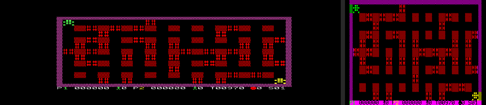

**[Play it in your browser](https://mzpico.com/play/bombernet/)**, or
download it for your machine from the
**[releases page](https://github.com/MZPico/BomberNet/releases)**.

## The game

Walk the maze, drop bombs, and blow up the walls and everything else in the
blast. Watch out for your own bombs.

- **Co-op**: one to four players work through the stages together, clearing
  out the monsters.
- **Deathmatch**: no monsters, the players start in the corners. The last one
  standing wins the round (when time runs out, the one with the most kills),
  and the first to win three rounds wins the match.

Up to four people can play on one machine, sharing the keyboard and the
joysticks, or spread over several machines on the network, in any mix.

## Machines

| Machine | What you need | For network play | Files |
|---|---|---|---|
| Browser | a phone, tablet or computer | nothing more | [play online](https://mzpico.com/play/bombernet/) |
| Sharp MZ-800, MZ-700 | | an [MZPico](https://mzpico.com/) with the NET extension, or a Unicard with NET firmware (home network) | `.mzf` |
| ZX Spectrum | 48K or larger | a Spectranet or Spectranext; on a 128K, an ESP-01 Wi-Fi module (eLeMeNt ZX) | `.tap` (`LOAD ""`) |
| Amstrad CPC | CPC 464 or larger | an M4 board | `.dsk`, `.cpc` |
| Atari XL/XE | 64 KB | a FujiNet | `.xex` |
| Commodore 64 | | a WiC64, or an Ultimate 64 / Ultimate-II+ with its network | `.prg`, `.d64` |
| Amiga | Kickstart 2.04 or later, 512 KB chip RAM (1 MB recommended) | a network connection with a TCP/IP stack (Roadshow, AmiTCP, Miami; built into WinUAE and FS-UAE) | program, `.adf` |
| Atari ST, STE | 1 MB, colour monitor | a Wi-Fi modem on the serial port | `.prg`, `.st` |
| IBM PC | DOS, from an 8088 up; CGA, EGA or VGA; PC speaker, AdLib or Sound Blaster | Ethernet with a DOS packet driver, or a Wi-Fi modem on COM1/COM2 | `.exe`, `.img` |

Every release has a file for each machine, named
`bombernet-<version>-<machine>`. The Sharp files are also on the
[catalog page](https://mzpico.com/titles/bombernet/).

## Pictures

| | |
|---|---|
|  Sharp MZ-800 | 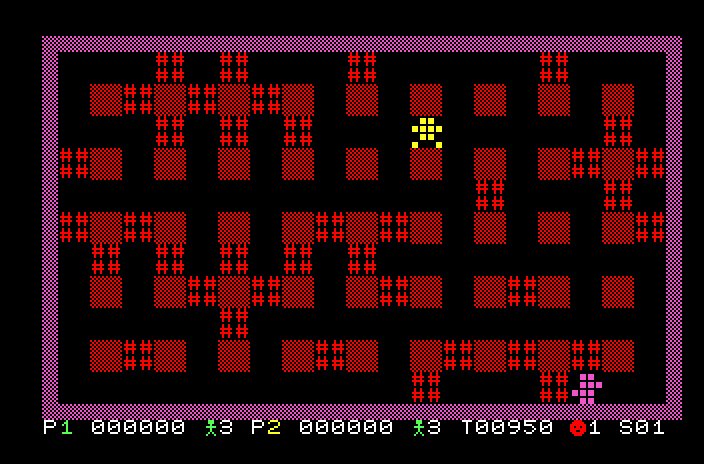 Sharp MZ-800, co-op |
| 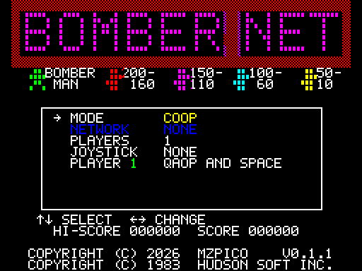 ZX Spectrum | 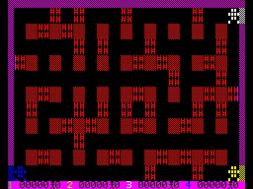 ZX Spectrum, deathmatch |
| 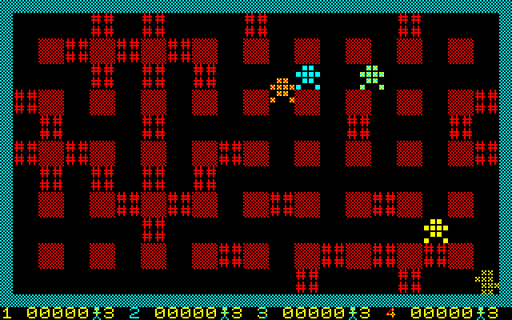 Amstrad CPC | 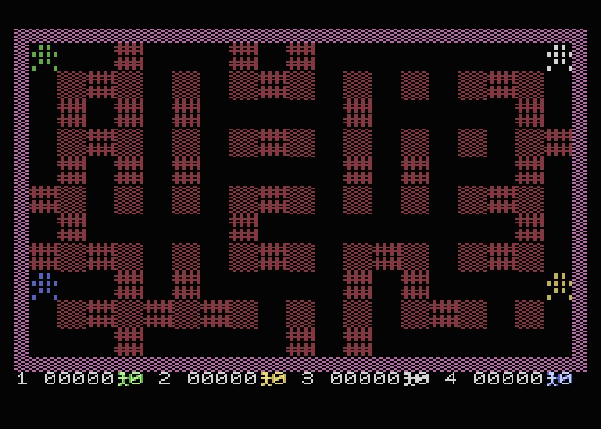 Atari XL, four players |
| 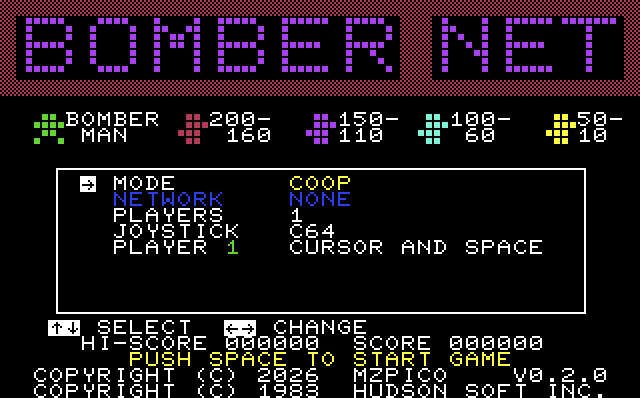 Commodore 64 | 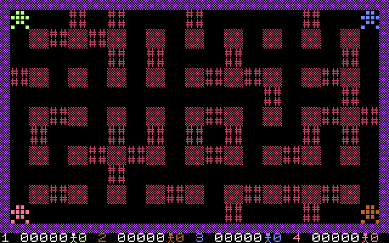 Commodore 64, four players |
| 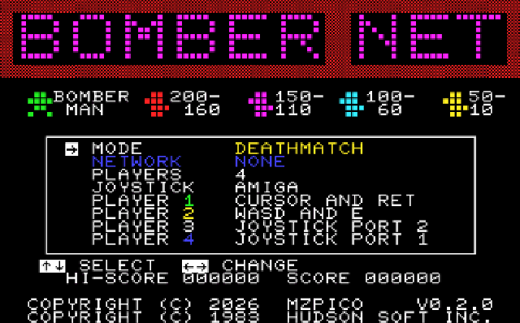 Amiga | 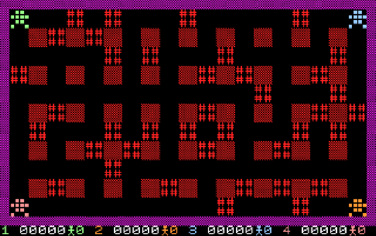 Amiga, four players |
| 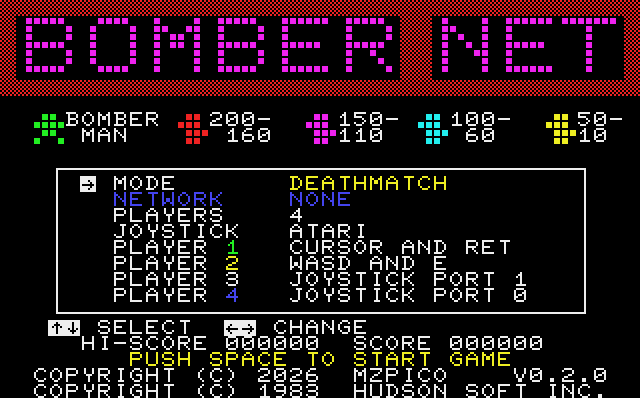 Atari ST | 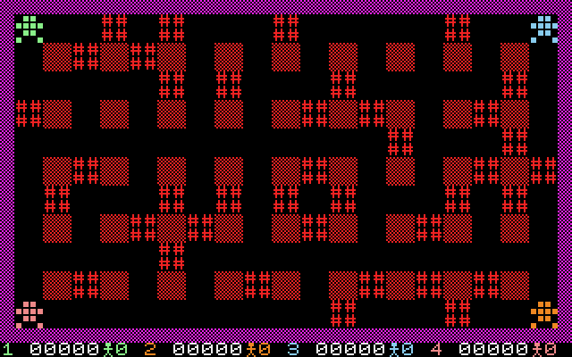 Atari ST, four players |
| 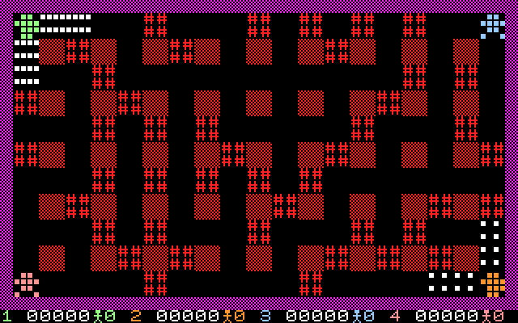 IBM PC (VGA) | 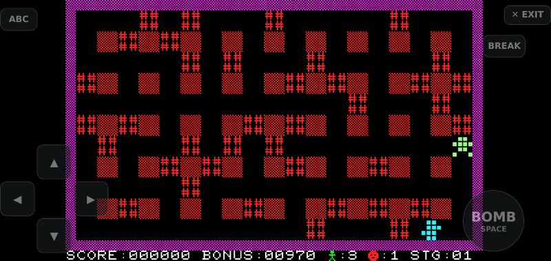 Browser on a phone, with touch controls |

## How to play

On the title screen, UP and DOWN choose a line, LEFT and RIGHT change it,
SPACE (or fire) starts the game:

- **MODE**: co-op or deathmatch.
- **NETWORK**: off, host or join (shown when the machine has a network
  device).
- **PLAYERS**: how many play in total, 1 to 4.
- **LOCAL**: in a network game, how many of them sit at this machine.
- **JOYSTICK**: the kind of joystick interface, where there is a choice.
- **PLAYER 1** to **4**: each local player picks keys or a joystick.

| Machine | Keys | Joysticks | Leave a match |
|---|---|---|---|
| Sharp MZ | cursor keys and SPACE; W A S D and E | MZ-800 joystick ports, MZ-1X03 | BREAK |
| ZX Spectrum | Q A O P and SPACE; the Sinclair keys 6 to 0 and 1 to 5 | Kempston, Fuller, Cursor | BREAK (CAPS SHIFT + SPACE) |
| Amstrad CPC | cursor keys and SPACE; W A S D and E | two joysticks | ESC |
| Atari XL/XE | arrow keys and SHIFT | two joysticks | ESC |
| Commodore 64 | cursor keys and SPACE; W A S D and E | ports 1 and 2 | RUN/STOP |
| Amiga, Atari ST | cursor keys and SPACE; W A S D and E | two joysticks | ESC |
| IBM PC | cursor keys and SPACE; W A S D and E | two game-port joysticks | ESC |
| Browser | cursor keys and SPACE; W A S D and E; on a phone, the buttons on the screen | gamepads | ESC, or the BREAK button |

## Network play

1. One player sets NETWORK to **HOST** and starts. The game opens a room and
   shows its four-letter **room code**.
2. Tell the others the code (by message, by phone). They set NETWORK to
   **JOIN** and type it in.
3. In the lobby everybody presses SPACE when ready, the host last, and the
   match begins.

Any machines can play together, each with one or more local players. Before
the match the game measures the connection and picks the input delay shown
in the lobby (DELAY, usually 120 ms); it adjusts during the match as the
connection allows. If the machines ever disagree or a player drops out, the
match ends with a message.

The matches go through a relay server on the internet (mzpico.com). You can
also run your own relay for a home network; see
[for developers](docs/development.md#a-relay-of-your-own).

## About

BomberNet started as a complete disassembly of the original 1983 tape and
grew into one C program for every machine. It is made by
[MZPico](https://mzpico.com/). The 128K Spectrum with an ESP-01 is
Milan Stava's port. *Bomber Man* (C) 1983 Hudson Soft.

How it is built, how the network works and how it is tested:
**[BomberNet for developers](docs/development.md)**.
