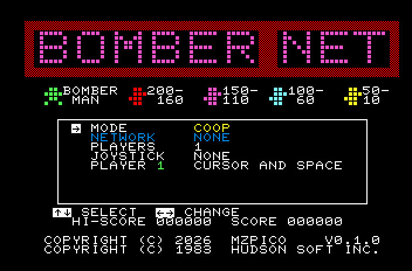
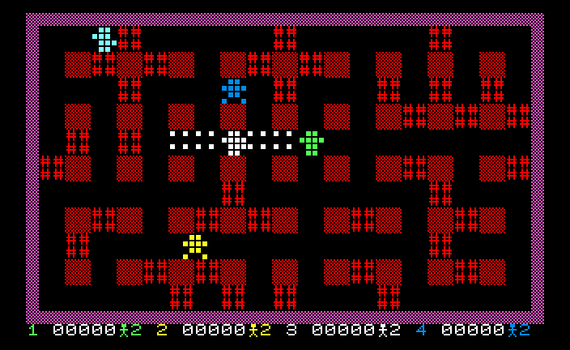
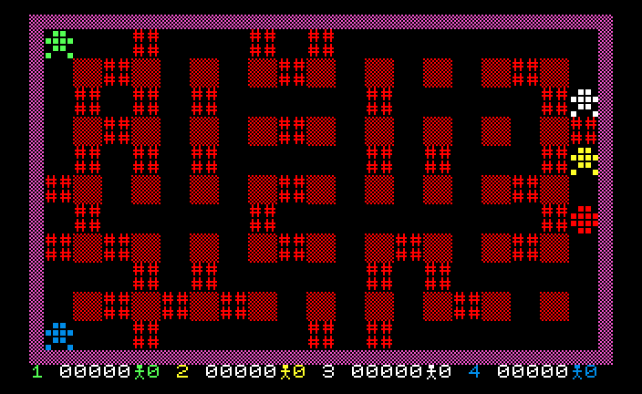

# BomberNet

**Bomberman for the classic home computers, with network play.**

BomberNet is Hudson Soft's 1983 *Bomber Man* for the Sharp MZ-700, rebuilt
for up to four players: together against the monsters or against each other,
on one keyboard, with joysticks, or over the internet. It runs on the Sharp
MZ-800, the ZX Spectrum, the Amstrad CPC, the Atari XL, the Commodore 64, the
Amiga, the Atari ST, the IBM PC and in your browser, and all of them can meet
in one match.

**[Play it in your browser](https://mzpico.com/play/bombernet/)**, or
download it for your machine from the
**[releases page](https://github.com/MZPico/BomberNet/releases)**.

## The game

Walk the maze, drop bombs, and blow up the walls and everything else in the
blast, your own player included.

- **Co-op**: one to four players work through the stages together, clearing
  out the monsters.
- **Deathmatch**: no monsters, the players start in the corners. The last one
  standing wins the round, and the first to win three rounds wins the match.

Up to four people play on one machine, sharing the keyboard and the
joysticks, or on several machines over the network, in any mix.

## Machines

| Machine | For network play you need |
|---|---|
| Browser (phone, tablet or computer) | nothing more |
| Sharp MZ-800 (the MZ-700 plays locally) | an [MZPico](https://mzpico.com/) with the NET extension; or a Unicard with the NET firmware, on a home network with a relay of your own |
| ZX Spectrum 48K or larger | a Spectranet or Spectranext; on a 128K, an ESP-01 Wi-Fi module |
| Amstrad CPC | an M4 board |
| Atari XL/XE | a FujiNet |
| Commodore 64 | a WiC64, or an Ultimate 64 / Ultimate-II+ |
| Amiga (Kickstart 2.04 or later) | a network connection with a TCP/IP stack |
| Atari ST, STE (1 MB, colour) | a Wi-Fi modem on the serial port |
| IBM PC (DOS, CGA, EGA or VGA) | Ethernet with a packet driver, or a Wi-Fi modem |

Every machine plays on its own without any of these.

## How to play

On the title screen, UP and DOWN choose a line, LEFT and RIGHT change it, and
SPACE starts: the mode, the network (host or join), how many players, and for
each player the keys or a joystick. The usual keys are the cursor keys and
SPACE, or W A S D and E for a second player (Q A O P and SPACE on the
Spectrum). BREAK, ESC or RUN/STOP leaves a match.

## Network play

1. One player chooses **HOST**. The game shows a four-letter **room code**.
2. The others choose **JOIN** and type the code in.
3. In the lobby everybody presses SPACE when ready, and the match begins.

Any machines can play together, each with one or more players at it.

## About

Made by [MZPico](https://mzpico.com/). The 128K Spectrum with an ESP-01 is
Milan Stava's port. *Bomber Man* (C) 1983 Hudson Soft.

For developers: [how it is built, how the network works, how it is
tested](docs/development.md).
